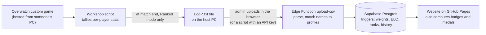
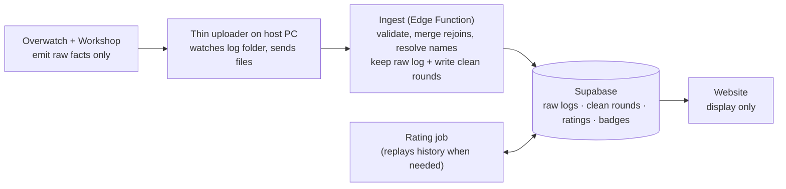

# Data flow

How match data gets from an Overwatch lobby to the website.

## Current

- The [Workshop script](https://workshop.codes/widowhs) writes one record per
  player still in the lobby when someone reaches the kill target. Players who
  left earlier are not logged.
- Nothing in this repository watches the host PC. The `upload-csv` API-key
  path is commented as being for a Python caller, which is not in the repo.
- Processing happens in four places: Workshop, Edge Function, database
  triggers and the browser.

## Proposed

- Processing lives in the ingest step, not on the host PC. There may be several
  hosts, the rating needs the full history, and renames, merges and bans must
  be able to re-run processing.
- Raw logs are stored unchanged so any processing change can be replayed.
- Badges and medals move server-side; the website only displays results.
