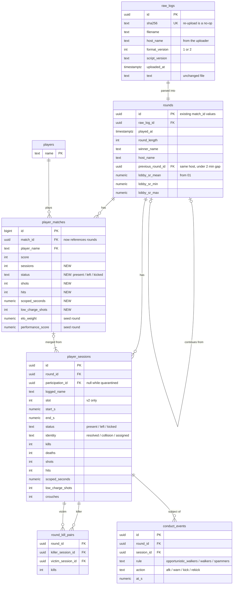
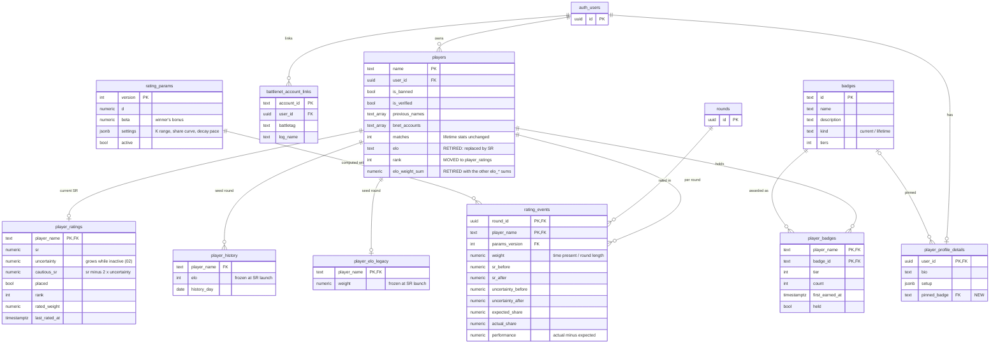

# Database schema after the briefs

The target `public` schema once all [briefs](briefs/README.md) are built.
Only key columns are shown. Based on the production schema of 30 October 2026
plus later migrations, none of which add tables.

Players are keyed by `name`, as today; renames cascade.

## Ingest and rounds

From [00](briefs/00-logging-and-ingest.md), [03](briefs/03-conduct.md) and
[06](briefs/06-identity.md).

v1 logs also get one session per row (start = round length − time in lobby,
status present), so overlap, collisions and head-to-head use one table for
both formats.

## Players, ratings and badges

From [01](briefs/01-skill-rating.md), [02](briefs/02-rating-decay.md) and
[05](briefs/05-badges.md). Head-to-head ([04](briefs/04-head-to-head.md))
adds no tables; it reads `rating_events`, `player_matches`, `player_sessions`
and `round_kill_pairs`.

`rating_drift_daily` (day, active players, mean SR, re-anchor shift) stands
alone and is not drawn. `audit_logs`, `leaderboard_state` and
`battlenet_oauth_requests` are unchanged and not shown.

## Changes by table

| Table | Change | Brief |
|---|---|---|
| `raw_logs` | New | 00 |
| `rounds` | New, backfilled from existing `match_id` values | 00, 01, 06 |
| `player_sessions` | New, backfilled from existing rows | 00, 06 |
| `round_kill_pairs` | New, v2 rounds only | 00 |
| `conduct_events` | New, v2 rounds only | 03 |
| `player_matches` | `match_id` references `rounds`; new shot, scope, session and status columns; ELO weight kept for the seed round | 00 |
| `player_ratings` | New; takes over `rank` | 01, 02 |
| `rating_events` | New, one row per player per rated round | 01 |
| `rating_params` | New, so every rating can be replayed exactly | 01 |
| `rating_drift_daily` | New | 02 |
| `badges`, `player_badges` | New; achievements and stat medals move here from the browser | 05 |
| `player_profile_details` | Adds `pinned_badge` | 05 |
| `players` | `elo`, `rank` and the `elo_*` sums retired; other stats unchanged | 01 |
| `player_history`, `player_elo_legacy` | Frozen at SR launch as seed-round history | 01 |
